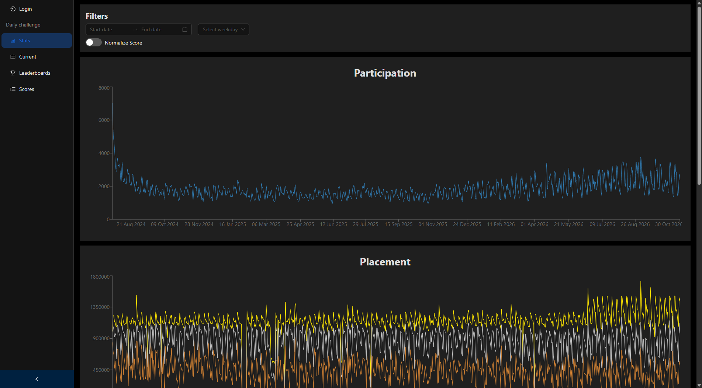

# how-web

Web app for [howbot.net](https://howbot.net), a public site of osu! daily challenge statistics. It reads challenge, profile, and score data from MongoDB and serves charts, leaderboards, and player pages.



The home page redirects to `/daily-challenge/stats`.

## Features

| Page         | Route                             | What it shows                                                                                                                                                               |
| ------------ | --------------------------------- | --------------------------------------------------------------------------------------------------------------------------------------------------------------------------- |
| Stats        | `/daily-challenge/stats`          | Participation and placement charts, forced and used mods, player retention. Filter by date range and weekday.                                                               |
| Current      | `/daily-challenge/detail/current` | Today's playlist item: beatmap, required mods, and score thresholds. Any past day is at `/daily-challenge/detail/YYYY-MM-DD`. A logged-in player also sees their own score. |
| Leaderboards | `/daily-challenge/leaderboards`   | Players ranked by plays, total score, pp, rank 1s, or percentile buckets. Search by username. Logged-in players see their own row.                                          |
| Scores       | `/daily-challenge/scores`         | Score table, sortable by performance, score, accuracy, rank, or date. Filter by player or challenge date.                                                                   |
| Player       | `/daily-challenge/user/[id]`      | Participation calendar, placement and score charts, rank history, and that player's scores.                                                                                 |

Sign in with osu! from the sidebar. Logout clears the session cookie via `GET /api/logout`.

## Stack

- [Next.js 15](https://nextjs.org/) (Pages Router) and React 19
- [tRPC](https://trpc.io/) with TanStack Query and Zod
- MongoDB via Mongoose
- Ant Design (dark theme) and Recharts
- pnpm

## Data

This app does not call the osu! API for rooms or scores. A separate importer keeps the collections below up to date; that process is what feeds the production site. An empty database loads the UI with no chart or table data.

| Collection              | Contents                                                                           |
| ----------------------- | ---------------------------------------------------------------------------------- |
| `dailychallenge`        | One document per daily challenge room                                              |
| `dailychallengeprofile` | Per-player aggregates (placements, streaks, statistics)                            |
| `dailychallengescore`   | Individual scores                                                                  |
| `users`                 | Accounts used for login. Documents are expected to exist before a player signs in. |
| `sessions`              | Created by this app on login                                                       |

## Requirements

- Node.js 20 or newer
- [pnpm](https://pnpm.io/)
- A MongoDB database that already contains the collections above

## Setup

```bash
pnpm install
cp .env.local.example .env.local
pnpm dev
```

Open [http://localhost:3000](http://localhost:3000).

### Environment

Copy `.env.local.example` to `.env.local` and fill in the values.

| Variable            | Purpose                                                                 |
| ------------------- | ----------------------------------------------------------------------- |
| `OSU_CLIENT_ID`     | osu! OAuth client id                                                    |
| `OSU_CLIENT_SECRET` | osu! OAuth client secret                                                |
| `OSU_RETURN_URL`    | osu! OAuth callback, for example `http://localhost:3000/api/return/osu` |
| `DEPLOYMENT`        | Deployment name                                                         |
| `MONGODB_URI`       | MongoDB connection string                                               |

After expansion, the Login button opens a URL like this (scopes `identify`, `friends.read`, and `public`):

```text
https://osu.ppy.sh/oauth/authorize?client_id=CLIENT_ID&redirect_uri=http://localhost:3000/api/return/osu&response_type=code&scope=identify+friends.read+public
```

Register that same redirect URI on the [osu! OAuth application](https://osu.ppy.sh/home/account/edit#new-oauth-application).

Login looks up an existing `users` document by `osu.userId`, or by `osuTemp` when the OAuth `state` query param is set. osu! tokens are written back to that document only when `NODE_ENV` is `production`. The session cookie is `HttpOnly`, `Secure`, and `SameSite=Strict`, so a local `http://` origin will not keep the user signed in.

## Scripts

| Command      | Description                                 |
| ------------ | ------------------------------------------- |
| `pnpm dev`   | Development server on port 3000             |
| `pnpm build` | Production build (`next build --turbopack`) |
| `pnpm start` | Production server on port 8443              |
| `pnpm lint`  | ESLint (`next lint`)                        |

`pnpm install` sets up a Husky pre-commit hook that runs Prettier through lint-staged.

## Production

[`pm2.json`](pm2.json) starts the app with `pnpm run start` under the process name `how-web`:

```bash
pnpm build
pm2 start pm2.json
```

## Layout

```text
src/
  pages/                  Routes and API handlers
    daily-challenge/      Stats, challenge detail, leaderboards, scores, player
    api/return/osu.ts     osu! OAuth callback
    api/trpc/[trpc].ts    tRPC endpoint
  server/routers/         tRPC routers (`user`, `dailyChallenge`)
  models/                 Mongoose models and collection names
  components/             Shared UI
  utils/osu/              Mod names and daily-challenge helpers
```
